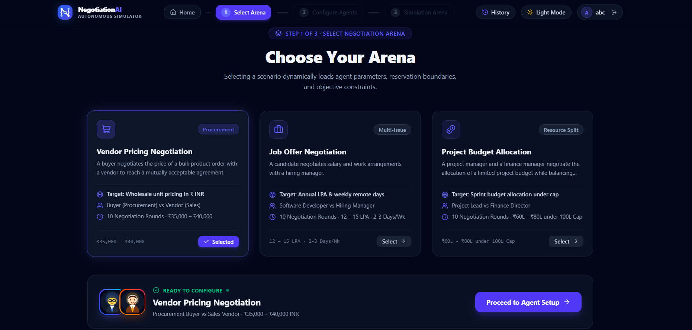
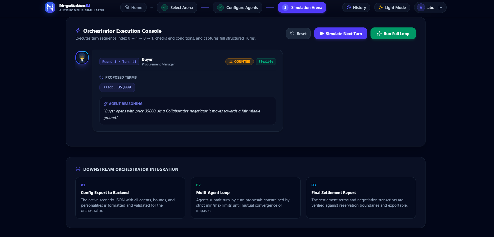
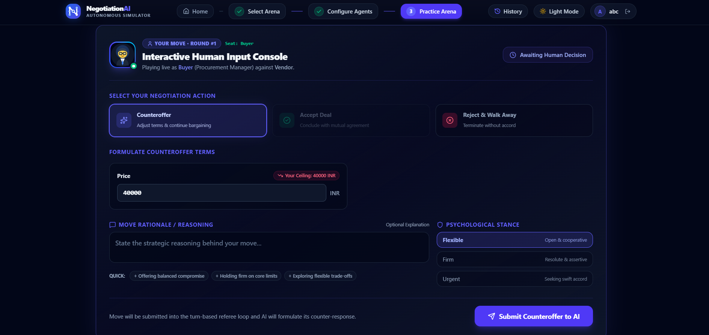
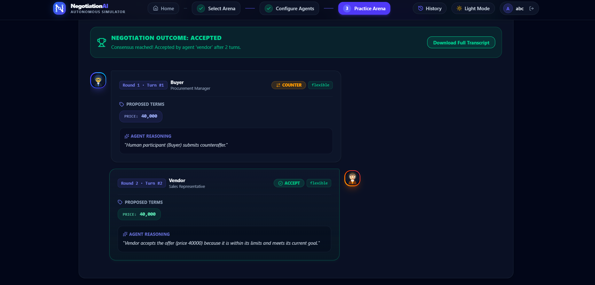
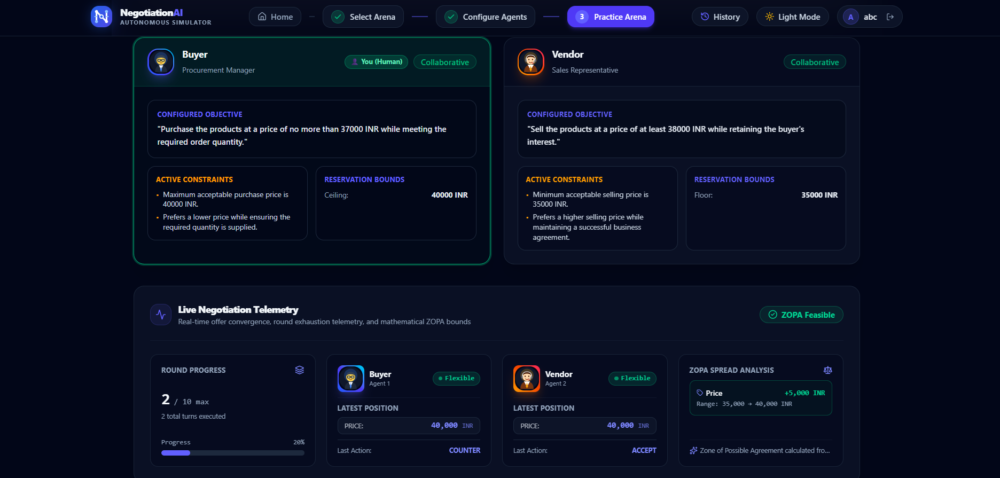

# Task 4 – Negotiation Arena, Practice Mode & Deadlock Handling

## 1. Project and Task Details

| Item | Details |
|---|---|
| Project | Multi-Agent Negotiation Simulator |
| Task | Task 4 – Negotiation Arena, Practice Mode & Deadlock Handling |
| Report | Automated testing results |

## 2. Objective of Testing

The objective was to verify the negotiation orchestration and related Task 4 functionality, including counteroffers, human turns, Practice Mode, and deadlock detection. Testing also covered API endpoints, configuration validation, AI reasoning, and fallback behaviour.

## 3. Testing Environment

- **Operating system:** Windows
- **Python:** 3.13.17
- **Pytest:** 9.1.1

## 4. Automated Test Results

| Test Module | Total | Passed | Failed |
|---|---:|---:|---:|
| Orchestrator | 14 | 14 | 0 |
| Counteroffer | 4 | 4 | 0 |
| Practice Mode | 10 | 10 | 0 |
| Validation | 31 | 31 | 0 |
| API | 46 | 46 | 0 |
| LLM Engine | 62 | 62 | 0 |
| **Total** | **167** | **167** | **0** |

The API tests reported a Starlette deprecation warning. The warning did not cause a test failure.

## 5. Functional Areas Verified

The automated tests covered:

- Negotiation orchestration and turn handling
- Counteroffer behaviour
- Human turn creation and Practice Mode interactions
- Deadlock detection and related handling
- API endpoints
- Configuration validation
- AI reasoning and fallback behaviour

## 6. Test Execution Summary

The supplied automated test results report **167 tests passed and 0 failed** across the six test modules listed above. The API suite included a Starlette deprecation warning, with no associated test failure.

Manual UI testing is not reported as complete in this document.

## 7. Conclusion

Based on the supplied results, all 167 reported automated tests passed. The reported deprecation warning did not affect the API test outcome. Manual UI testing remains outside the results documented here.

## Application Screenshots

The following screenshots provide visual evidence of Task 4 application functionality.

### 1. Scenario Selection

### 2. Simulation Mode

### 3. Practice Mode

### 4. Final Negotiation Result

### 5. Negotiation Metrics
