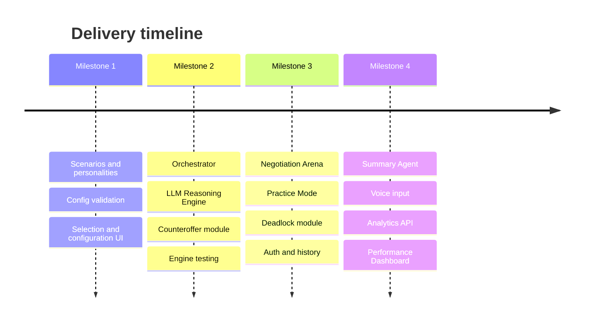
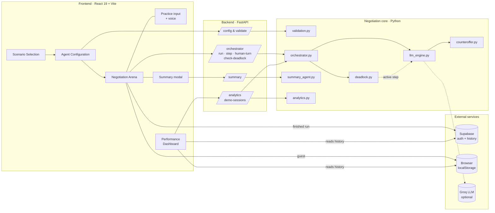
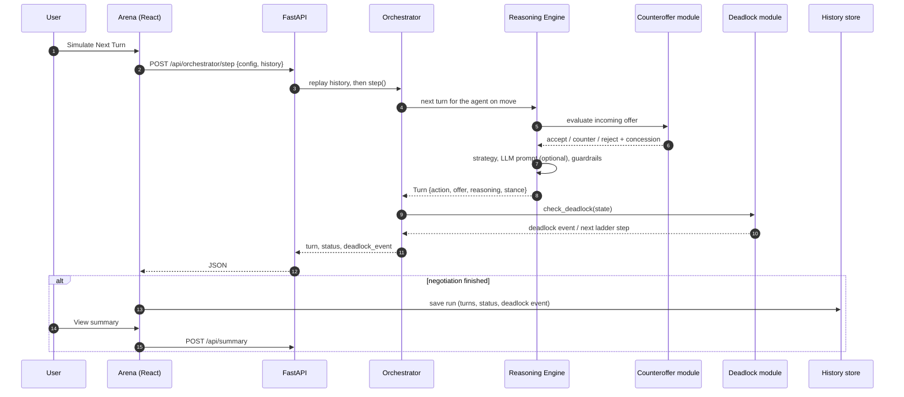
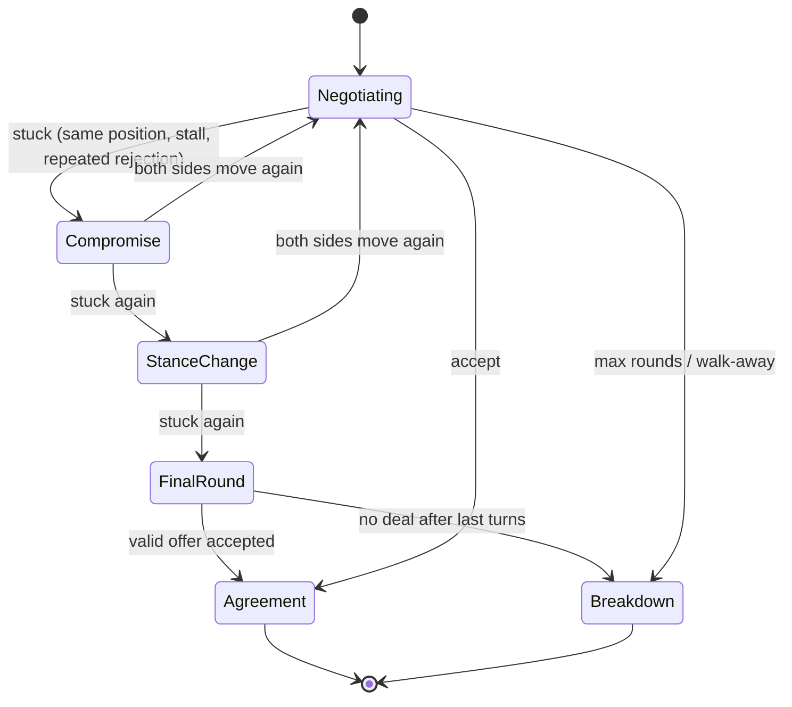
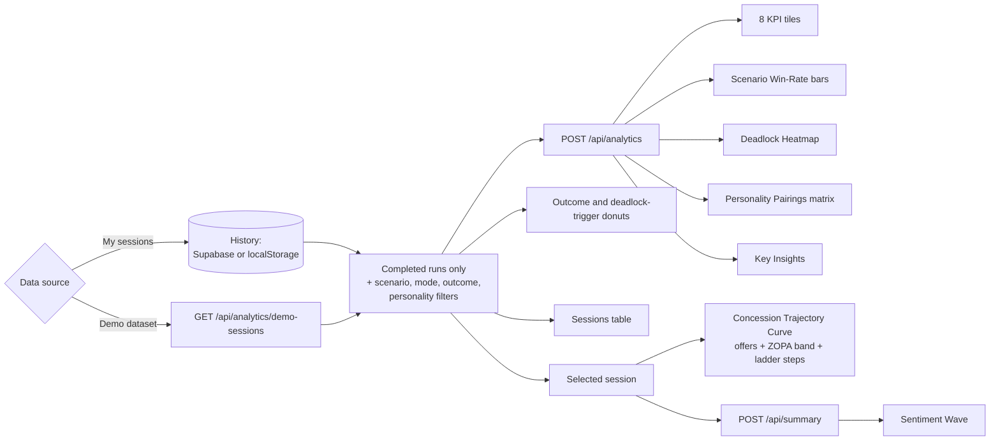
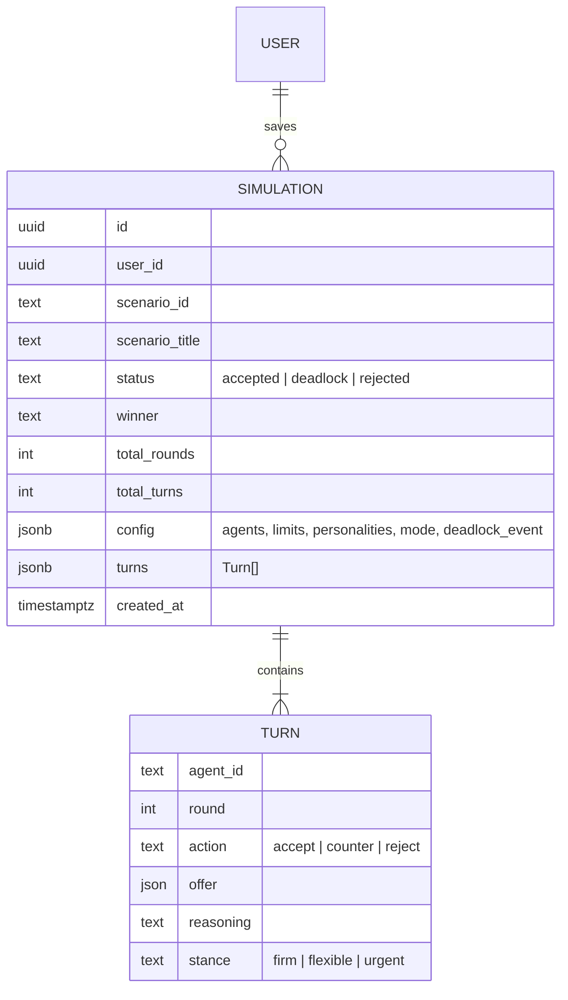

# Milestone 4 Report: Insights, Analytics and Final System Architecture

AI-Driven Multi-Agent Negotiation Training & Simulation Platform

This report closes Milestone 4. It describes what Milestone 4 added (the Post-Interaction
Summary Agent, voice input, multi-session analytics and the Performance Dashboard), the bugs
found and fixed while integrating it, and the complete system architecture across all four
milestones.

---

## 1. Milestones at a glance

| Milestone | Theme | Main deliverables |
|---|---|---|
| 1 | Foundation | Scenario library (3 scenarios), personality model, config validation, FastAPI backend, scenario selection and agent configuration UI |
| 2 | Reasoning engine | Orchestrator turn loop, LLM Reasoning Engine with rule-based fallback, Counteroffer & Concession Module, Task 3 testing |
| 3 | Negotiation Arena | Live arena, Practice Mode (human vs AI), Deadlock Detection & Resolution, Supabase auth and history |
| 4 | Insights | Post-Interaction Summary Agent, voice input, multi-session analytics, **Performance Dashboard**, this report |



---

## 2. System architecture



### Layers

| Layer | Responsibility | Key files |
|---|---|---|
| Presentation | Screens, charts, practice input, theming | `frontend/src/App.jsx`, `components/*.jsx` |
| API | REST endpoints, validation errors, Swagger docs | `backend/main.py`, `backend/routers/*.py` |
| Negotiation core | Turn loop, agent reasoning, concessions, deadlocks | `orchestrator.py`, `llm_engine.py`, `counteroffer.py`, `deadlock.py` |
| Insights | Per-session report and cross-session metrics | `summary_agent.py`, `analytics.py` |
| Persistence | Accounts and run history | Supabase (`supabase_schema.sql`), browser localStorage fallback |
| AI provider | Optional LLM reasoning | Groq OpenAI-compatible API (`.env`, never committed) |

The platform runs without any API key: the rule-based engine plays every turn, and the LLM is
used only when a key is configured.

---

## 3. How one negotiation flows



In Practice Mode the human's turn goes to `POST /api/orchestrator/human-turn`, which records
it in the same `Turn` shape and lets the AI reply in the same call.

### Deadlock resolution ladder



---

## 4. What Milestone 4 adds

### 4.1 Post-Interaction Summary Agent (`backend/summary_agent.py`, `POST /api/summary`)

- Resolution quality score (0-100) from four parts: agreement outcome (40), pacing efficiency
  (20), concession reciprocity (20) and boundary safety (20), with a quality tier.
- Sentiment journey: a sentiment label and score (-1 to 1) for every turn, from action and stance.
- Personalised recommendations for each agent.
- Shown in the arena's summary modal, and plotted as the Sentiment Wave on the dashboard.

### 4.2 Voice input (`HumanInputPanel.jsx`)

In Practice Mode the human can dictate reasoning with the browser's Web Speech API; browsers
without speech support fall back to typing.

### 4.3 Multi-session analytics (`backend/analytics.py`)

`POST /api/analytics` takes saved sessions and returns:

| Output | Meaning |
|---|---|
| `agreement_rate`, `deadlock_rate`, `avg_rounds` | Headline KPIs over completed runs only; `deadlock_rate` counts runs that ended in deadlock |
| `deadlock_events`, `deadlock_event_rate`, `no_deal_rate` | Runs where a deadlock was detected at any point (resolved or not), and runs that ended without an agreement |
| `resolved_by_ladder` | Runs that hit a deadlock but still ended in a deal |
| `deadlock_triggers` | How often each deadlock type occurred |
| `scenario_breakdown` | Agreement, deadlock rate and rounds per scenario |
| `win_rates` | Per scenario: which agent captured more of the deal zone (ZOPA) |
| `deadlock_heatmap` | Scenario x {agreement, each trigger, breakdown, walk-away} counts and rates |
| `personality_matrix` | Personality pairing x agreement rate, deadlock frequency and rounds |
| `key_insights` | Plain statements generated only from the data |

**Value share (win-rate).** For an agreed deal, the final value's position inside the ZOPA
decides who captured more. Example: in Vendor Pricing (ZOPA 35,000-40,000) a deal at 36,000 gives
the buyer 80% of the zone and the vendor 20%. A split within ±5% of the middle counts as even.

`GET /api/analytics/demo-sessions` returns a demo dataset of 30 negotiations that the engine
really plays: all 3 scenarios x 9 personality pairings, plus 3 Practice Mode runs where a
stubborn human repeats one offer. It is deterministic (no LLM, no randomness).

### 4.4 Performance Dashboard (`frontend/src/components/PerformanceDashboard.jsx`)

A new **Dashboard** tab in the main navigation (the arena's *Analytics* button opens it too).
The page has three views (**Overview**, **Sessions**, **Scenarios**) and a filter panel on the
right (at the top on phones): data source, scenario, mode (simulation / practice), outcome
(agreement / no deal) and personality (either agent).



| View | What it shows |
|---|---|
| KPI tiles (Overview) | Eight tiles: completed runs, agreement rate, deadlock rate (runs where a deadlock was detected, even if the ladder then found a deal), mediator success (stuck runs that still closed), no-deal rate (runs that ended without an agreement), average rounds, practice sessions, average turns |
| Outcome donut (Overview) | Share of runs ending in agreement, deadlock or walk-away, total in the centre |
| Deadlock trigger donut (Overview) | First deadlock each run hit (repeated rejection, same position, stall, max rounds) or never stuck |
| Concession Trajectory Curve | Both agents' offers turn by turn converging inside the shaded ZOPA, each party's limit, deadlock ladder steps as markers, the final deal point; item switch for multi-item scenarios (salary / remote days) |
| Sessions table (Sessions tab) | Every filtered run: scenario, personality pairing, mode, turns, outcome, deal value and deadlock type; clicking a row charts it on the Overview |
| Sentiment Wave | Per-turn sentiment of each agent from the Summary Agent (with an offline estimate if the API is down) |
| Scenario Win-Rate (Overview and Scenarios tab) | Share of deals where each side captured more of the zone, plus average value share |
| Deadlock Heatmap (Scenarios tab) | Scenario x trigger/outcome grid, colour intensity = rate, numbers always shown |
| Personality Pairings (Scenarios tab) | 3x3 matrix: average rounds and deadlock frequency per pairing |
| Key Insights (filter panel) | Generated sentences, never claims beyond the data |

It works in dark and light themes and on phones; an empty history shows a call to action with
the demo dataset instead of fake numbers.

---

## 5. Bugs found and fixed during Milestone 4

| # | Bug | Impact | Fix |
|---|---|---|---|
| 1 | Runs finished with **Simulate Next Turn** were never saved to History | Step-by-step runs (the normal demo flow) never reached History or analytics | The step path now saves the run when the status becomes final |
| 2 | The deadlock event was not stored with a run | Analytics could not tell which deadlock happened | The event is saved with the run (inside `config`, no table change) and read back by analytics |
| 3 | The old analytics modal always showed hard-coded sample numbers | Users saw statistics that were not theirs | Replaced by the dashboard, which reads real history and labels the demo dataset clearly |
| 4 | `POST /api/analytics` with no sessions silently returned sample data; unfinished runs were counted; a missing round count crashed (`None + int`) | Misleading or failing metrics | Empty input returns zeros; only accepted / deadlock / rejected runs count; rounds derived safely |
| 5 | Deadlocks with no event were labelled `same_position`; insights claimed a "primary driver" even when every count was 0 | Wrong insight text | Counted as `unclassified`; insights only state what the data shows |
| 6 | Job Offer and Project Budget always ended on turn 2: the agent accepted an offer on its own hard limit because the scenario goal only restates that limit | 2 of 3 scenarios had no real negotiation | The counteroffer module's accept is honoured only for offers in the part of the range the agent is ready to give up by now (better half early, widening as time runs out); all 27 personality pairings now negotiate |
| 7 | `test_config_to_orchestrator_runs_rule_based_negotiation` checked concession direction backwards | Hidden until bug 6 was fixed | Assertion corrected: a max-limited agent only moves up, a min-limited agent only down |
| 8 | `test_all_scenarios_run_in_orchestrator` failed about 1 run in 5 | Flaky CI | The random mock repeats Job Offer salaries (12/13/14), so the deadlock module correctly ends some runs early; the test now accepts that outcome |
| 9 | The Summary dossier and the config screen's pop-ups opened underneath the sticky navigation bar (they were trapped inside `<main>`'s stacking layer) | Dossier title and close button hidden on laptop-height screens | Rendered into `<body>` with a React portal |
| 10 | 12 frontend lint errors on main (unused imports, state set synchronously in an effect, a stale directive) | `npm run lint` failed | Fixed; the summary modal now never shows the previous run's report while loading |

Effect of bug fix 6 on the 27 rule-based runs (3 scenarios x 9 pairings):

| Scenario | Before | After |
|---|---|---|
| Vendor Pricing | 3-9 turns, deals mid-zone | unchanged |
| Job Offer | always 2 turns, deal at the employer's maximum (15 LPA) | 3-10 turns, deals between 12.8 and 14.0 LPA |
| Project Budget Allocation | always 2 turns, deal at the PM's request | 3-10 turns, deals between 66.5 and 73.6 lakh |

---

## 6. Data model



Signed-in users' runs go to the Supabase `simulations` table; guests' runs stay in the browser
(`localStorage`). Both use the same record shape, so the dashboard reads either.

---

## 7. API reference (all milestones)

| Method | Path | Purpose |
|---|---|---|
| GET | `/api/health` | Health check |
| GET | `/api/scenarios`, `/api/scenarios/{id}` | Scenario library |
| GET | `/api/personalities` | The three personalities |
| POST | `/api/validate` | Validate a negotiation config |
| POST | `/api/config` | Build and validate a config from a scenario and personality choices |
| POST | `/api/orchestrator/run` | Full negotiation loop |
| POST | `/api/orchestrator/step` | Next turn only (step-by-step arena) |
| POST | `/api/orchestrator/human-turn` | Practice Mode human turn + AI reply |
| POST | `/api/orchestrator/check-deadlock` | Deadlock state and next resolution step |
| GET | `/api/orchestrator/engine` | Active engine (LLM or rule-based) |
| POST | `/api/summary` | Post-interaction summary, quality score, sentiment, recommendations |
| GET / POST | `/api/analytics` | Benchmark / cross-session analytics |
| GET | `/api/analytics/demo-sessions` | 30 engine-played sessions for the dashboard demo |

Interactive documentation: `http://localhost:8000/docs`.

---

## 8. Quality and testing

| Suite | Tests | Covers |
|---|---|---|
| `test_validation.py` | 69 | Config rules, limits, ZOPA, max rounds, deadlock settings |
| `test_api.py` | 68 | Every endpoint, errors, full config-to-orchestrator flow |
| `test_llm_engine.py` | 63 | Strategy, prompts, JSON parsing, guardrails, fallback, accept rule |
| `test_deadlock.py` | 41 | Detection rules, ladder, engine follow-through, API |
| `test_orchestrator.py` | 14 | Turn order, rounds, end conditions |
| `test_dashboard_analytics.py` | 14 | Record normalisation, value share, deadlock rates, heatmap, matrix, demo dataset |
| `test_practice_mode.py` | 11 | Human turns, waiting state, practice deadlocks |
| `test_summary_analytics.py` | 5 | Summary agent and baseline analytics |
| `test_counteroffer.py` | 4 | Accept / counter / reject logic |
| **Total** | **289** | all passing; frontend lint clean; production build passes |

Run everything:

```bash
python -m pytest -q
cd frontend && npm run lint && npm run build
```

The dashboard was also checked in a real browser (desktop and phone widths, dark and light
themes): empty history, the user's own runs, the demo dataset, every filter and all three
tabs, with no console errors and no horizontal scrolling on a 390 px phone.

---

## 9. Known limitations and next steps

- **Small samples.** Win-rates and the personality matrix are only meaningful with several runs
  per scenario and pairing; the dashboard always shows run counts next to rates.
- **Rule-based demo data.** The demo dataset is played by the rule-based engine so that it is
  free and repeatable; LLM runs are saved and analysed the same way once a key is configured.
- **Breakdowns are rare by design.** With a valid deal zone the resolution ladder usually finds a
  deal, so most deadlock activity appears as rescued runs rather than breakdowns.
- **Bundle size.** The production bundle is above Vite's 500 kB warning; lazy-loading the
  dashboard and summary modal is the next optimisation.
- **Next:** export the dashboard as a PDF report, compare a user's practice sessions over time,
  and stream LLM reasoning live in the arena.
